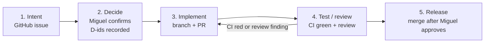

# Delivery process

Every change to this repository follows these five stages, in order. That includes content syncs, design work, tooling and changes to this knowledge base. CI gates each stage, and no stage begins while CI is red (D15).



## 1. Intent

- Open a GitHub issue in `websublime/docs` using the **Intent** template. It states what is wanted, why, what is in scope and what is not.
- One issue covers one deliverable. Split large asks into several intents.
- A sync run (D7) opens its own intent, naming the project and the ref range (`lastSynced..ref`).

## 2. Decide

- List the open choices. Where a choice has real tradeoffs, present the options to Miguel with a recommendation. Act only after he confirms.
- **Never make a solution simpler just to move forward.** If a simpler solution looks tempting, stop and ask Miguel.
- Record each confirmed decision in `knowledge/decisions.md` (new D-id, or an amendment), in the same pull request that implements it.
- Decisions already in the log are not reopened. Changing one needs a new intent.

## 3. Implement (pull request)

- Branch from an up-to-date `main`, named `<type>/<short-slug>`. Types: `feat`, `fix`, `docs`, `chore`, `sync`.
- Keep the pull request limited to its intent. Link the intent with `Closes #<n>`.
- The pull request template's checklist must be complete before review is requested.
- Content rules:
  - English only (D4).
  - No internal material (D3).
  - The code is the source of truth (D2).
  - The documented ref follows D5.
  - Accent scopes and class-name rules follow D11.

## 4. Test and review

- **CI must be green.** Every check on the pull request must pass:
  - the `CI` workflow, which runs on every pull request and on `main`: `mint validate`, `mint broken-links`, the line://ui asset check `node scripts/line-ui.mjs --check`, the leak lint, the sync registry validation, and the generated-page and navigation checks;
  - the checks the Mintlify GitHub App adds: `Mintlify Deployment` (preview build), `link-rot` and `vale-spellcheck`.

  A pull request with any red check is not ready. One exception (D18): when `Mintlify Deployment` is **skipped** for the head commit because it touched only `.mintignore` paths, the app's validation checks do not count. The `CI` workflow is then the gate. A failed deployment always blocks.

  A second exception (D19): an app check that fails with "An unknown error occurred", whose own output shows no finding, does not block when its CI equivalent passed (`link-rot` ↔ `mint broken-links`). Record the check-run id and the Mintlify report in the pull request.
- **When CI fails:**
  - stop;
  - read the failing log;
  - fix the cause in the same pull request;
  - push;
  - wait for CI again.
- **Never do any of these to get past a failure:**
  - skip, disable or weaken a check (`continue-on-error`, deleted steps, narrowed paths);
  - mark the failure as "known";
  - move on to other work.
- If the cause is outside this repository, or cannot be fixed, stop and report it to Miguel with the log.
- Run the same checks locally before pushing:
  ```bash
  npx mint@4.3.19 validate
  npx mint@4.3.19 broken-links
  node scripts/line-ui.mjs --check
  vale *.mdx */*.mdx   # same config as the Mintlify vale-spellcheck check (D21)
  bun scripts/leak-lint.ts
  bun scripts/sync.ts --validate
  bun scripts/gen.ts --check
  bun scripts/nav.ts --check
  ```
- **Visual changes:** check them in `mint dev`, in both light and dark mode, and attach screenshots to the pull request.
- **Review:** a reviewer pass (human, or the `code-reviewer`/`reviewer` agent) checks the change against its intent and the decisions log. Fix every finding in the same pull request, then go back through CI.

## 5. Release (merge)

- Merge only when all of these hold:
  - CI is green on the latest commit;
  - review findings are resolved;
  - **Miguel has approved the merge.**

  Agents never merge on their own.
- Mintlify deploys `main`. After the merge, check that the deployment succeeded. If it failed, open a `fix` intent straight away and do not start other work until it is fixed.
- A sync pull request updates `lastSynced` in `sync/registry.yaml` as part of the merge, never afterwards.
