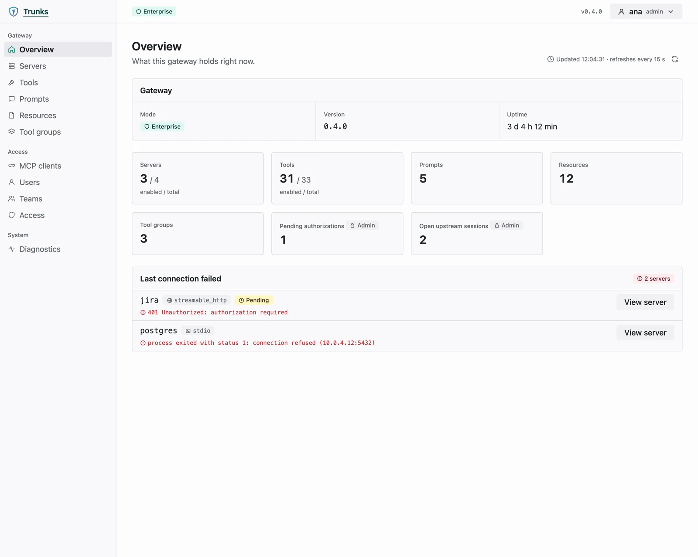
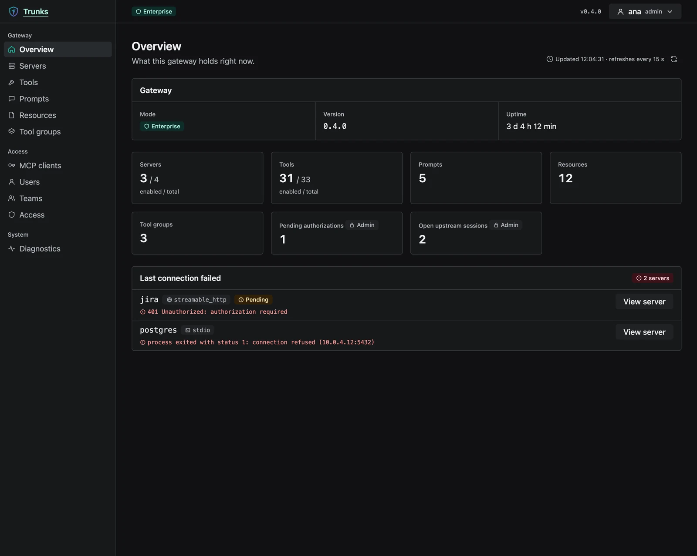
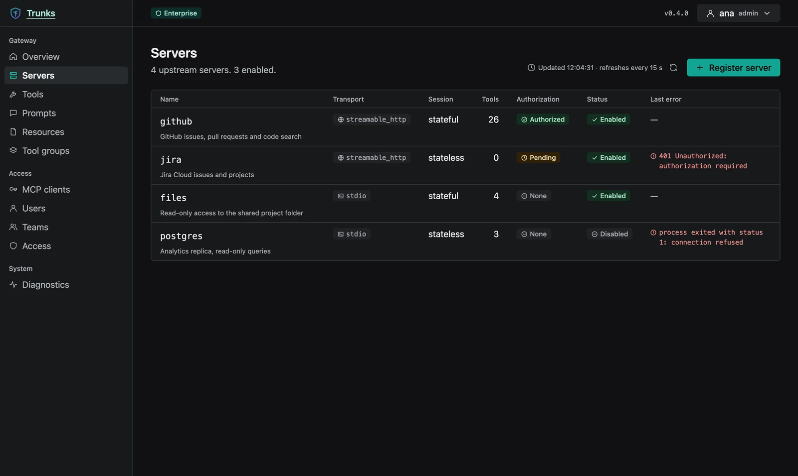
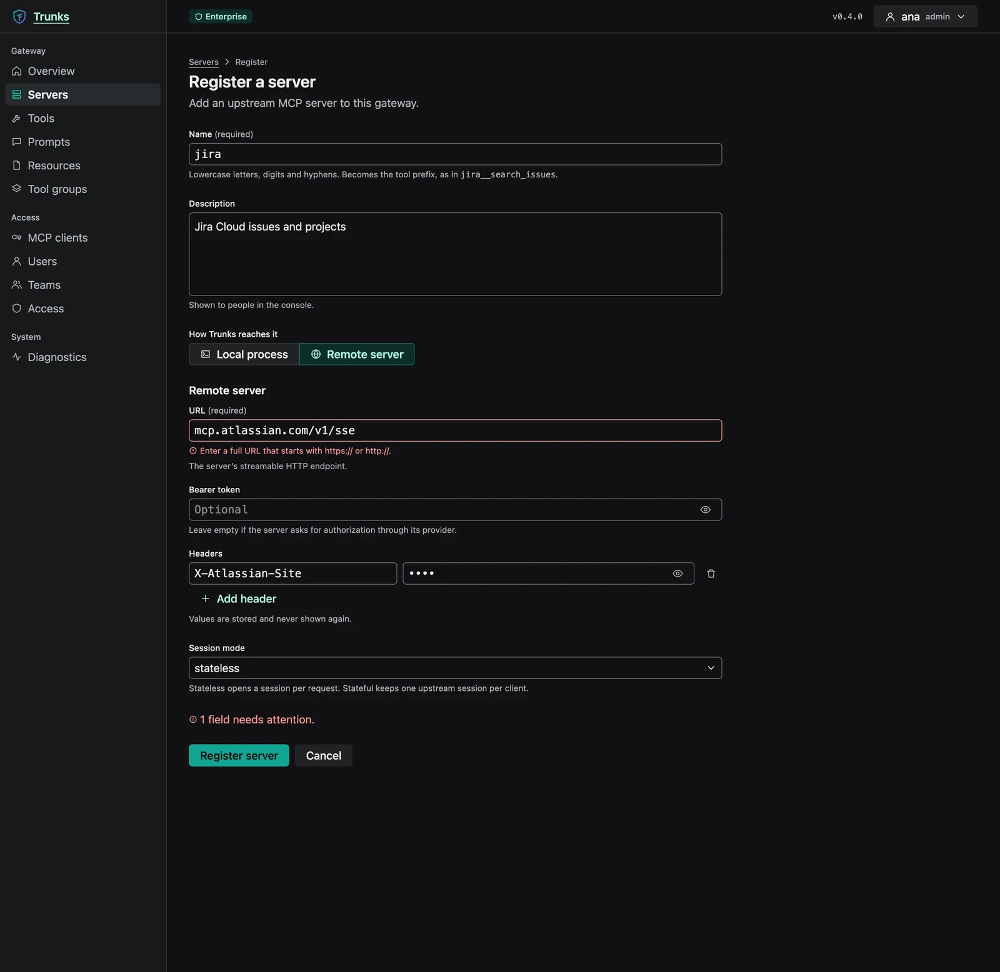
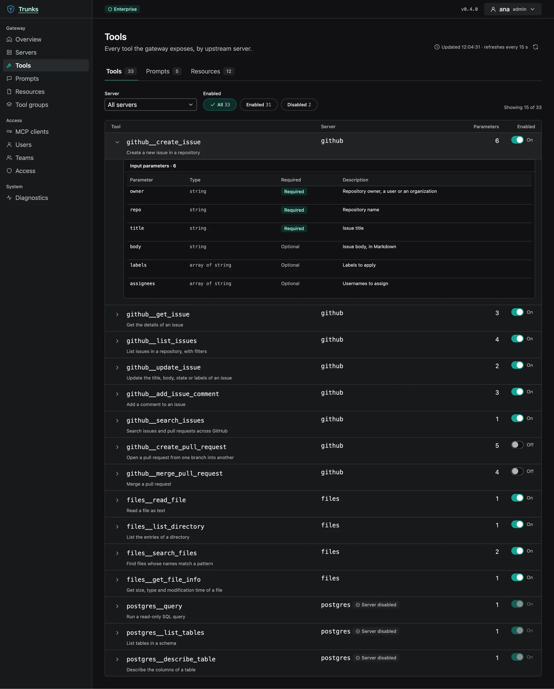
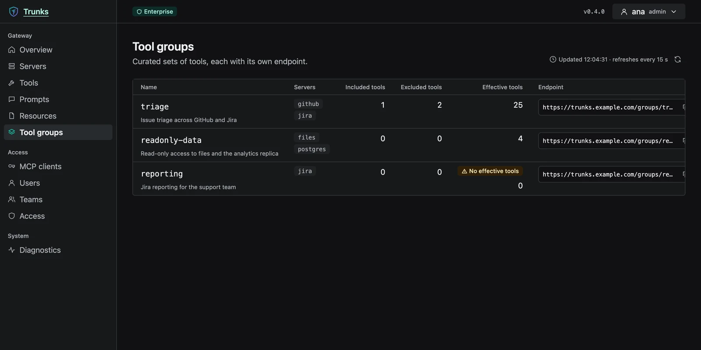
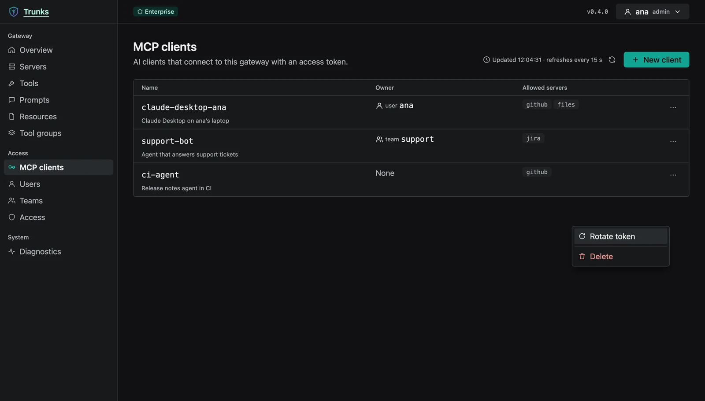
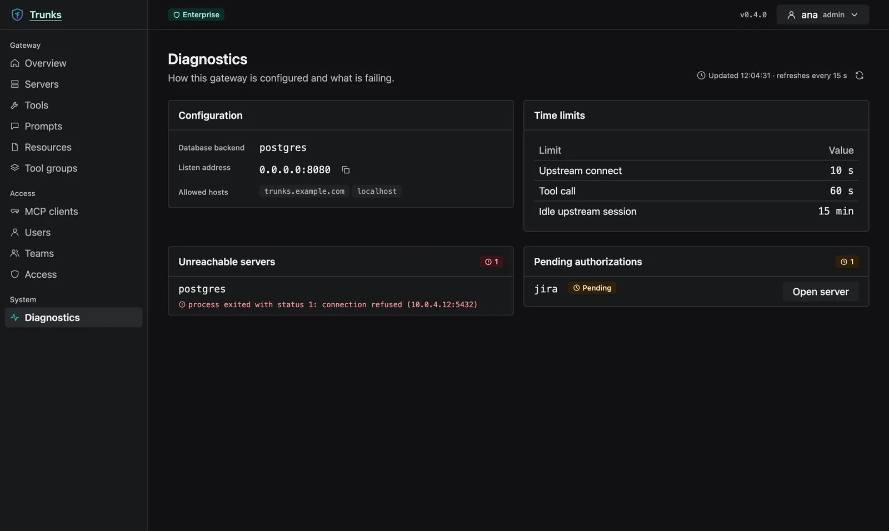

<div className="not-prose ws-hero" data-accent="teal">
  <div className="ws-hero-head">
    <span className="ws-badge ws-badge-rc">RC</span>
    <p className="ws-hero-tagline">Run all your MCP servers behind one endpoint.</p>
  </div>
  <div className="ws-stats">
    <div className="ws-stat"><span className="ws-stat-label">Version</span><span className="ws-stat-value">0.1.0-rc.2</span></div>
    <div className="ws-stat"><span className="ws-stat-label">License</span><span className="ws-stat-value">MPL-2.0</span></div>
    <div className="ws-stat"><span className="ws-stat-label">Stack</span><span className="ws-stat-value">Rust · MCP</span></div>
  </div>
  <div className="ws-actions">
    <a className="ws-button ws-button-solid" href="https://github.com/websublime/trunks">GitHub</a>
    <a className="ws-button" href="#install">Install</a>
  </div>
</div>

<Frame caption="Web console design (version 0.4.0): the gateway overview in enterprise mode. The v0.1.0-rc.2 console may look different.">
  
  
</Frame>

Trunks is a self-hosted MCP gateway and registry written in Rust. You register your MCP servers once, and your MCP clients and agents connect to a single Streamable HTTP endpoint. One binary is both the server (`trunks start`) and the management CLI. Use it alone on your machine in development mode, or share one server with a team in enterprise mode.

## What you can do

- Put any number of upstream MCP servers behind one endpoint, `/mcp`. Tools and prompts appear as `<server>__<name>`, and resources as `trunks://res/<server>/<encoded-uri>`.
- Connect upstreams over **stdio** (a process Trunks starts) or Streamable HTTP, with a bearer token, extra headers or OAuth 2.1.
- Publish a curated subset of tools as a tool group, on its own endpoint at `/v0/groups/<name>/mcp`.
- Run in enterprise mode with users, teams, per-resource grants, MCP client tokens and single sign-on (OIDC) for people.
- Manage everything from the CLI, the REST API under `/api/v0`, or the built-in web console.
- Store data in SQLite or PostgreSQL, and expose Prometheus metrics at `/metrics`.

## Web console

<Note>
  These images are designs of the web console. They show version 0.4.0. The console in `v0.1.0-rc.2` has the same pages, but it may not look exactly like this.
</Note>

<Tabs>
  <Tab title="Servers">
    <Frame caption="Upstream servers with their transport, session mode, tool count, authorization, status and last error.">
      
    </Frame>
  </Tab>
  <Tab title="Register">
    <Frame caption="Registering a remote server: URL, bearer token, headers and session mode.">
      
    </Frame>
  </Tab>
  <Tab title="Tools">
    <Frame caption="Every tool the gateway exposes, by upstream server, with its input parameters.">
      
    </Frame>
  </Tab>
  <Tab title="Tool groups">
    <Frame caption="Tool groups: curated sets of tools, each with its own endpoint.">
      
    </Frame>
  </Tab>
  <Tab title="MCP clients">
    <Frame caption="MCP clients that connect with an access token, their owners and allowed servers.">
      
    </Frame>
  </Tab>
  <Tab title="Diagnostics">
    <Frame caption="Diagnostics: configuration, time limits, unreachable servers and pending authorizations.">
      
    </Frame>
  </Tab>
</Tabs>

## Install

`v0.1.0-rc.2` is a pre-release. Name the tag in the installer URL, because the `latest/download` links only follow final releases.

<CodeGroup>
```bash macOS and Linux
curl --proto '=https' --tlsv1.2 -LsSf \
  https://github.com/websublime/trunks/releases/download/v0.1.0-rc.2/trunks-installer.sh | sh
```

```powershell Windows
powershell -ExecutionPolicy Bypass -c "irm https://github.com/websublime/trunks/releases/download/v0.1.0-rc.2/trunks-installer.ps1 | iex"
```

```bash From source
# Rust 1.94 or newer
cargo install --locked --git https://github.com/websublime/trunks --tag v0.1.0-rc.2 trunks
```

```bash Container
# add -stdio to the tag for Node.js 24 (npx) and uv (uvx)
docker run -d --name trunks -p 127.0.0.1:8080:8080 -v trunks-data:/data \
  -e TRUNKS_ALLOWED_HOSTS=localhost,127.0.0.1 \
  ghcr.io/websublime/trunks:v0.1.0-rc.2-stdio
```
</CodeGroup>

Release archives cover Linux (glibc and musl), macOS and Windows, on x86_64 and arm64. The images are built for `linux/amd64` and `linux/arm64`.

## Quick example

Start the server in development mode. It has no authentication and listens on `127.0.0.1:8080` only.

```bash
trunks start
```

In another terminal, register an MCP server, call one of its tools through the gateway, and connect Claude Code:

```bash
trunks register --name everything \
  --command npx --arg -y --arg @modelcontextprotocol/server-everything \
  --session-mode stateful
trunks invoke everything__echo --input '{"message":"hello"}'
claude mcp add --transport http trunks http://127.0.0.1:8080/mcp
```

## Status

`v0.1.0-rc.2` is a release candidate of the first public version. The gateway, registry, CLI, access model, single sign-on and web console are implemented and tested.

- `v0.1.0-rc.1` has container images but no binaries, because its release build failed. Use `v0.1.0-rc.2`.
- No final release exists yet, so the `latest` installer links and the `latest` and `latest-stdio` image tags do not resolve to this version.
- Trunks is not published on crates.io. The `trunks` crate there is an unrelated project, so `cargo install trunks` installs the wrong tool. Install from GitHub Releases, from source (`cargo install --git`) or from a container image.
- OIDC for MCP clients, organisations and declarative configuration are not part of this release.

## Next steps

<Columns cols={2}>
  <Card title="Quickstart" icon="rocket" href="/trunks/quickstart">
    Install Trunks, register a server and call your first tool.
  </Card>
  <Card title="Core concepts" icon="diagram-project" href="/trunks/concepts/core-concepts">
    Names, transports, session modes and endpoints.
  </Card>
  <Card title="Upstream servers" icon="server" href="/trunks/guides/upstream-servers">
    Connect stdio and Streamable HTTP servers, with OAuth when needed.
  </Card>
  <Card title="CLI reference" icon="terminal" href="/trunks/reference/cli">
    Every command and flag, generated from the binary.
  </Card>
</Columns>

## Links

- [GitHub repository](https://github.com/websublime/trunks)
- [Release `v0.1.0-rc.2`](https://github.com/websublime/trunks/releases/tag/v0.1.0-rc.2)
- [Changelog](/trunks/changelog)
- [Container images](https://github.com/websublime/trunks/pkgs/container/trunks)
- [License (MPL-2.0)](https://github.com/websublime/trunks/blob/v0.1.0-rc.2/LICENSE)

<Panel>
  <h3>Install</h3>

```bash
curl --proto '=https' --tlsv1.2 -LsSf \
  https://github.com/websublime/trunks/releases/download/v0.1.0-rc.2/trunks-installer.sh | sh
```

  <h3>Contribute</h3>

  <Steps>
    <Step title="Fork and clone">
      Fork [`websublime/trunks`](https://github.com/websublime/trunks) and clone it. You need Rust 1.94 or newer. Node 22 is only needed to build the web console.
    </Step>
    <Step title="Create a branch">
      Branch off `main` for your change.
    </Step>
    <Step title="Run the checks">
      Run `cargo xtask ci`. It runs `cargo fmt --check`, `clippy -D warnings` and the tests, as CI does.
    </Step>
    <Step title="Open a pull request">
      Push your branch and open a pull request against `main`.
    </Step>
  </Steps>

  <Tip>`trunks usage <tool>` prints a tool's description and input parameters before you call it with `trunks invoke`.</Tip>
</Panel>
